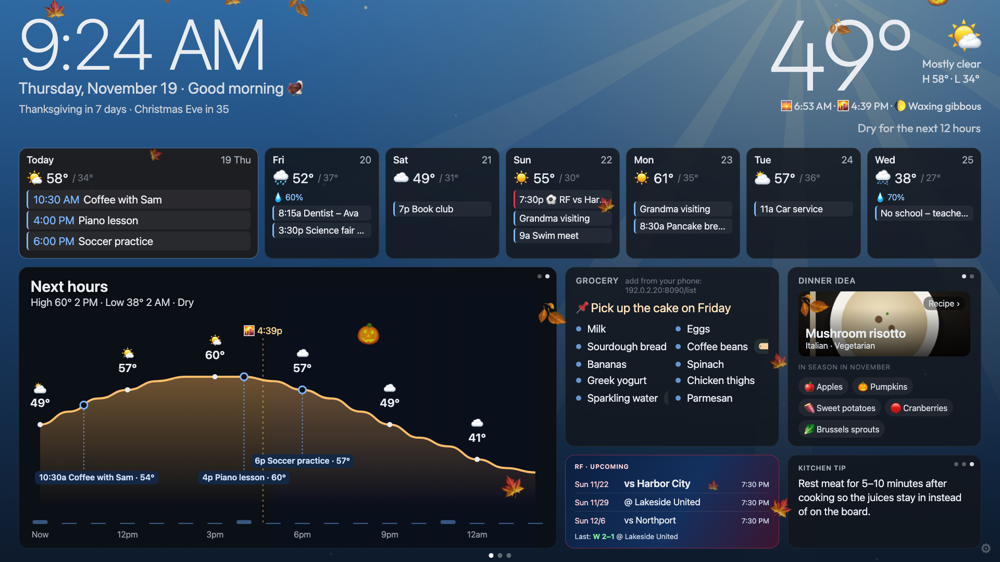
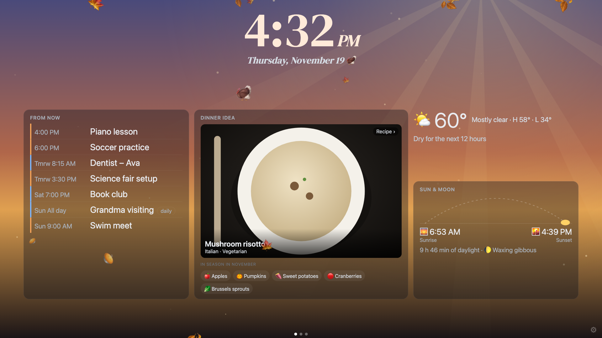
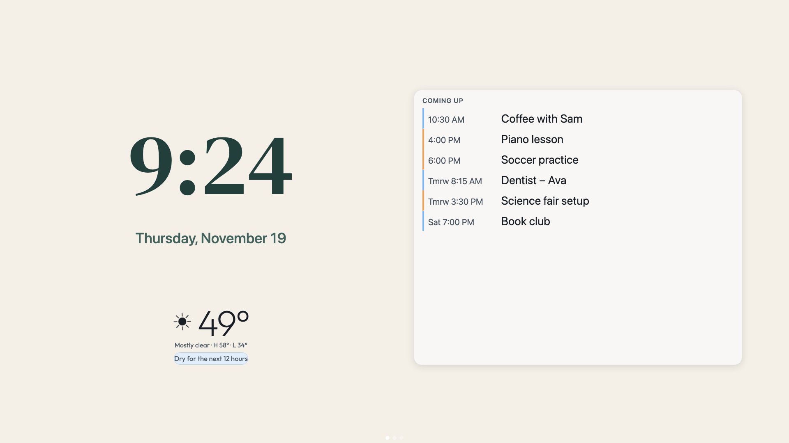
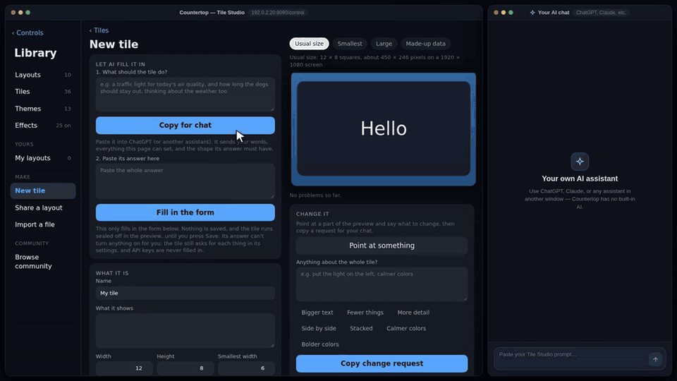
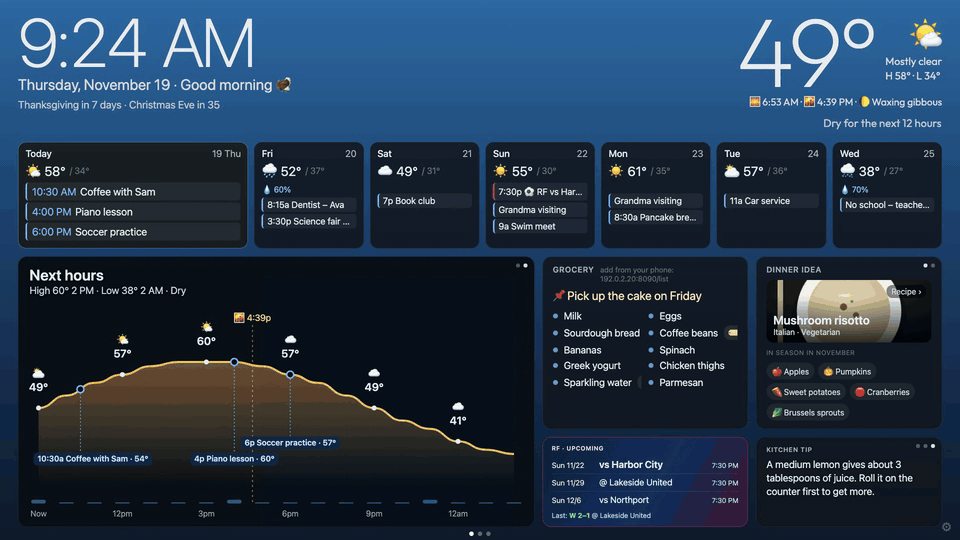

<h1 align="center">Countertop</h1>

<strong>Make your home screen your own.</strong>

  Put the family calendar, weather, and shared grocery list on your Echo Show 15 or another screen with a browser.
  Arrange it for the way your household gets through the day. No ads or subscription. You don’t need a Countertop account.

  Runs on a Mac, a Linux computer, or a Docker or Unraid server in your home. Your calendars, lists, and settings stay there.

  <a href="#make-it-yours">Make it yours</a> ·
  <a href="#what-it-can-do">What it can do</a> ·
  <a href="#it-follows-your-day">It follows your day</a> ·
  <a href="#get-started">Get started</a> ·
  <a href="#questions">Questions</a>

  

## Make it yours

Press and hold a tile to start editing right on the screen. Drag tiles where you want them, make the important ones bigger, and give the clock a look of its own. You can also make changes from a computer and preview them as you go.

### Many ways to set up the same screen

<table>
  <tr>
    <td width="33%" valign="top">
      
      <strong>Everyday</strong> The week, weather, and meal ideas all in view.
    </td>
    <td width="33%" valign="top">
      
      <strong>Atmospheric</strong> A sunset sky, glass tiles, and falling leaves.
    </td>
    <td width="33%" valign="top">
      
      <strong>Minimal</strong> A big clock, the next few plans, and the weather.
    </td>
  </tr>
</table>

Open any of the three layouts to see it full size. They all use the same fictional household data.

### Make your own tiles

Want something the built-in tiles don't do? Open **Tile Studio** (**Library → Tiles → New tile**) to write a tile of your own, or describe what you want, copy the prompt into ChatGPT, Claude, or another assistant you already use, and paste the answer back to fill in the form and live preview. Point at parts of the preview to ask for changes, switch between versions, and share your tile — or download tiles other people made in **Library → Community**.

*The chat window on the right is a simulated external assistant (ChatGPT, Claude, etc.), not part of Countertop — Countertop has no built-in AI, and Tile Studio works with whatever assistant you already use.*

## What it can do

<table>
  <tr>
    <td width="50%" valign="top">
      
      <strong>Share the grocery list.</strong> Add something from your phone’s browser and it shows up on your dashboard within half a minute. No app to install.
    </td>
    <td width="50%" valign="top">
      
      <strong>See the whole family’s plans.</strong> Put several calendars together, then switch between a quick look at the week and a full month.
    </td>
  </tr>
<tr>
  <td width="50%" valign="top">
    
    <strong>Keep an eye on your home.</strong> Connect Home Assistant to see lights, doors, and sensors alongside everything else. Switch lights or run scenes with a tap.
  </td>

  <td width="50%" valign="top">
      
      <strong>Make room for the fun stuff.</strong> Choose from more than 30 tiles, such as photos from a shared iCloud album, your soccer team’s next match, countdowns, planes overhead, and a dad joke.
    </td>
  </tr>
</table>

Meal ideas follow the time of day, from breakfast to dessert, and point out recipes that use something on your list or on sale. Tap one for the whole recipe and add what you need to the list. A box on the screen can hold several tiles that take turns, so meal ideas, deals, and a kitchen tip can share one spot without crowding the screen. Birthdays on the calendar set off confetti.

*All pictures show fictional data.*

## It follows your day

The sky behind your tiles follows the sun, from sunrise to sunset. At bedtime, a dim clock with your next event takes over. It moves a little each minute so nothing burns into the screen, and a tap brings the dashboard back for a moment.

Effects match the weather outside: rain, snow, fog, passing clouds, sun rays, and stars on clear nights. Falling leaves and holiday touches arrive at the right time of year. There are 25 effects in all, and you can turn each one on, off, or schedule it.

When rain is close, the radar can take over the space that normally shows your hourly forecast. Once the rain passes, that space goes back to the forecast.

Pick a theme for the colors, background and tiles, and schedule others by time of day, day of the week, or date, for example a calmer theme on weekends or a festive one in December.

*Shown with fictional weather and map data.*

## Set it and forget it

- **Stays on.** The dashboard keeps the Echo Show awake and full screen.
- **Updates itself.** Changes you make from Controls show up on the screen without touching it.
- **Recovers on its own.** It refreshes once a night and reloads if a page ever gets stuck.

## Good to know

- **You need a computer that stays on.** Countertop runs on a Mac, a Linux computer, or a Docker or Unraid server on your home network.
- **Designed for the Echo Show 15.** Layouts are made for its 1920×1080 screen in the Silk browser. A tablet or monitor with a modern browser works too.
- **Your grocery list can live where you like.** Use the built-in list from any phone, send an Apple Reminders list with an iPhone Shortcut or the Countertop Mac app, or point Countertop at a list that's online. See [list sync](docs/list-sync.md).
- **Works with Home Assistant.** Show lights, doors and sensors, and switch lights or run scenes from the screen. See [Home Assistant](docs/home-assistant.md).
- **Save and share layouts.** The Library keeps earlier layouts to switch back to, lets you try one on the screen for two minutes, and shares any layout as a small file with your calendars and personal text left out. Tiles, themes and your own emoji effects can be shared as files too, and Library → Community has layouts, tiles, themes and effects other people made, downloaded only when you choose. See [sharing and the community gallery](docs/sharing-layouts.md).
- **Some features are limited.** Store deals use US weekly ads by ZIP code. Sports cover soccer leagues such as MLS, NWSL, the Premier League, and the Champions League. Photos come from shared iCloud albums.
- **Keep it on your home network.** Anyone who can reach the dashboard can open Controls.

## Get started

1. **Run Countertop** on a computer or home server that stays on. On a Mac, [download the app](docs/setup.md#run-it-on-a-mac) and open it. For Docker, Unraid or Linux, see the [Docker and Unraid guide](docs/install-docker-unraid.md) or the [Linux steps](docs/setup.md#run-it-on-linux).
2. **Open it on your screen.** Use the dashboard address from setup. On an Echo Show 15, say **“Alexa, open Silk,”** open that address, and tap the page once to start full screen.
3. **Add your own details.** Open **Controls** from a computer or phone on the same home network. A short setup guide asks for your town, your calendar and where your grocery list lives. Preview six premade dashboards, keep the Everyday default, or start from scratch. Later, **Controls → Pages → Add page** adds swipeable pages, including full-screen ones like a month calendar. Tap **Main** to change its layout; earlier layouts stay in **Saved layouts**.

If something isn't working, **Controls → Status** shows what's wrong. Its **Download diagnostics** button saves a file to attach to a [bug report](https://github.com/kizit/countertop/issues/new?template=bug_report.yml), with your private links and location removed. See [what's new](CHANGELOG.md) in each version.

## Questions

<strong>Does Alexa still work?</strong>

Yes. Countertop is a web page in the Silk browser, so Alexa keeps listening as usual.

<strong>Do I need to install anything on the Echo Show?</strong>

No. There’s nothing to sideload and no developer mode. You open a web address in Silk and bookmark it.

<strong>What happens after a power cut or an Echo update?</strong>

Countertop starts again with your computer or server. If the Echo Show goes back to its home screen, open Silk again and tap the page once.

<strong>Can I use a tablet or a spare monitor instead?</strong>

Yes. Any screen with a modern browser works. Layouts are designed for a wide 16:9 screen, so a landscape tablet or monitor looks best.

---

[Setup tips and more details](docs/setup.md) · [Docker and Unraid](docs/install-docker-unraid.md) · [Contributing](CONTRIBUTING.md) · [Developing](docs/development.md) · [Writing a tile](docs/tile-api.md) · [MIT license](LICENSE)

Countertop is an independent project. Echo, Echo Show, Alexa, and Silk are trademarks of Amazon.com, Inc.
