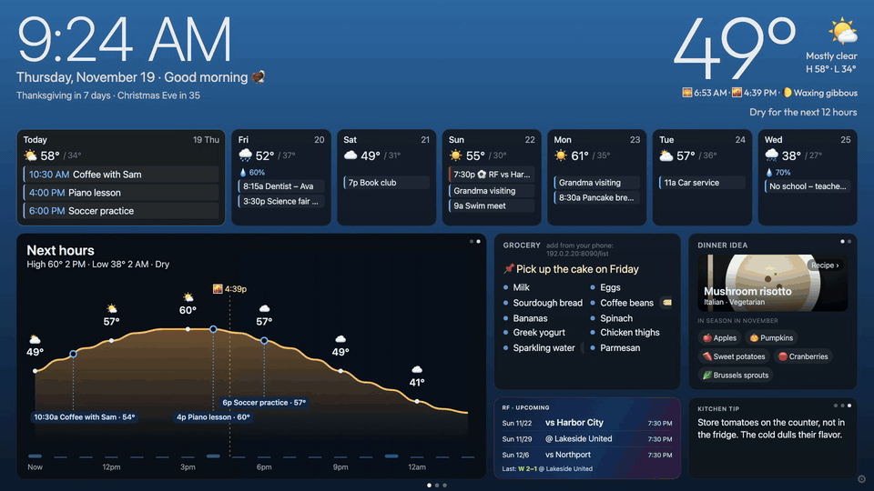

<h1 align="center">Countertop</h1>

<strong>Make your kitchen screen your own.</strong>

  Put the family calendar, weather, and shared grocery list on your Echo Show 15 or another screen with a browser.
  Arrange it for the way your household gets through the day. No ads or subscription. You don’t need a Countertop account.

  <a href="#make-it-yours">Make it yours</a> ·
  <a href="#what-it-can-do">What it can do</a> ·
  <a href="#get-started">Get started</a>

  

## Make it yours

Press and hold a tile to start editing right on the screen. Drag tiles where you want them, make the important ones bigger, and give the clock a look of its own. You can also make changes from a computer and preview them as you go.

### Three ways to set up the same screen

<table>
  <tr>
    <td width="33%" valign="top">
      
      <strong>Everyday</strong> The week, weather, and dinner plans all in view.
    </td>
    <td width="33%" valign="top">
      
      <strong>Atmospheric</strong> A sunset sky, glass tiles, and falling leaves.
    </td>
    <td width="33%" valign="top">
      
      <strong>Minimal</strong> A big clock, the next few plans, and the weather.
    </td>
  </tr>
</table>

Give a busy week its own page, schedule a different look for weekends, or wind down with a dim clock that shows tomorrow’s first event. Open any of the three layouts to see it full size. They all use the same fictional household data.

## What it can do

- **See the whole family’s plans.** Put multiple calendars together and switch between a quick look at the week and a full month.
- **Share the grocery list.** Add something from your phone’s browser and it shows up on the kitchen screen.
- **Answer “What’s for dinner?”** Tap a dinner idea to see its ingredients and steps, or check what’s on sale.
- **Make room for the fun stuff.** Add family photos, your team’s next match, or a countdown to something you’re looking forward to.

### See rain coming

When rain is close, the radar can take over the space that normally shows your hourly forecast. Once the rain passes, that space goes back to the forecast.

*Shown with fictional weather and map data.*

## Get started

1. **Run Countertop** on a computer or home server that stays on. Use the [Mac or Linux setup guide](docs/setup.md) or the [Docker and Unraid guide](docs/install-docker-unraid.md).
2. **Open it on your screen.** Use the dashboard address from setup. On an Echo Show 15, say **“Alexa, open Silk,”** open that address, and tap the page once to start full screen.
3. **Add your own details.** Open **Controls** from a computer on the same home network, then set your location and connect your calendars. Start with a few favorite tiles and arrange the rest whenever you like.

Countertop lives on your home network. Keep it there, since anyone who can reach the dashboard can open Controls.

[Setup tips and more details](docs/setup.md) · [MIT license](LICENSE)
