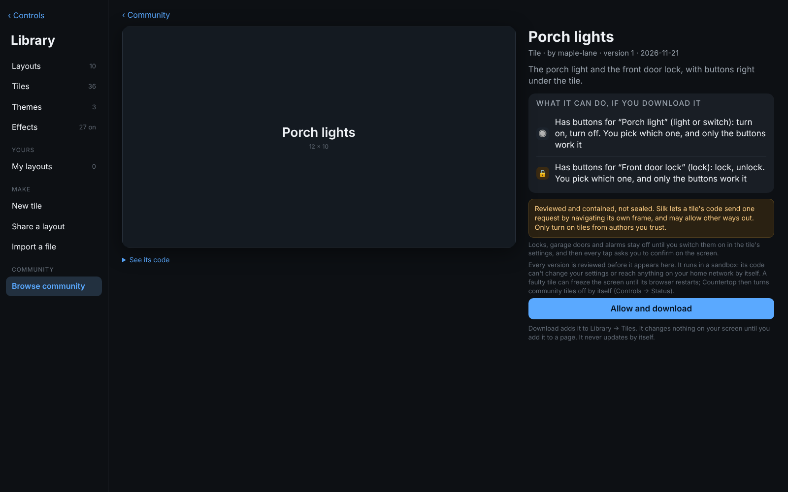
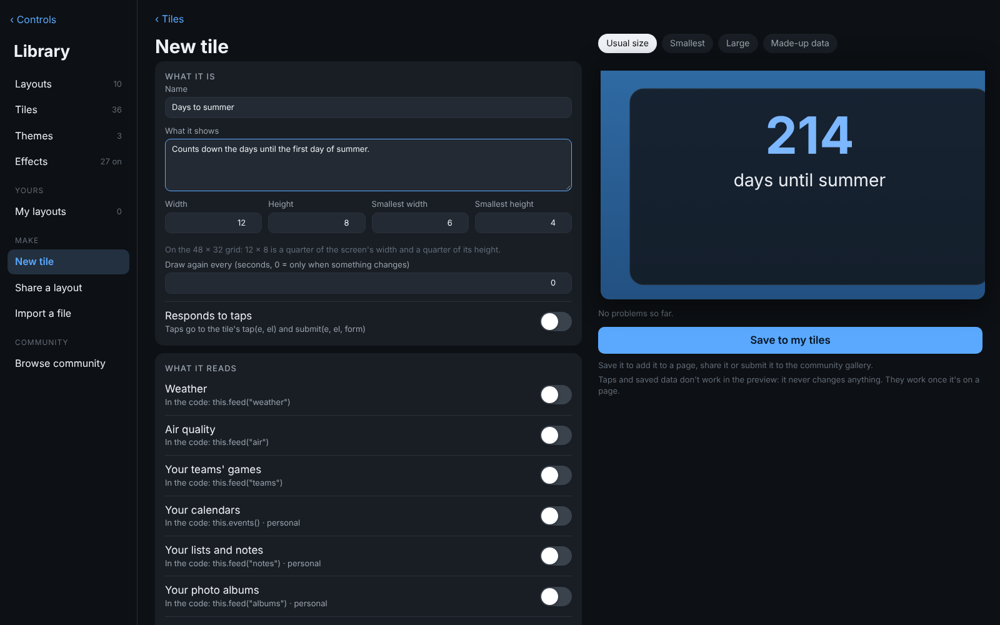

**Anyone can now make a tile, share it and download other people's. Safely.**

Last time the Library gave layouts, themes and effects a home, and Community let people share them. Now tiles join in. Community tiles are tiles other people wrote, and **Tile Studio** lets you write your own, with a live preview, and share it.

## Community tiles

**Library → Community** now lists tiles as well. Before you download one, the tile's page tells you exactly what it can do:

- what it can see: your weather, calendar, lists, photos or sales
- which websites it reads
- any key it needs (you type it into the tile's settings)
- any devices it has buttons for, such as a light or a lock through Home Assistant

Downloading adds the tile to Library → Tiles and changes nothing on your screen until you put it on a page. Updates never install by themselves, and a new version that can do more than the old one asks you again. If the gallery takes a tile down, it stops on your screens within a day.

## Tile Studio

**Library → Tiles → New tile** is a place to make your own. Describe the tile and press **Copy for chat**, paste the assistant's answer back, and **Fill in the form** sets everything on the page at once: name, what it shows, size, the data it reads, settings and code. Or fill in the form and write the code yourself. Either way you watch the tile run in a preview with made-up data or your own. Problems are listed as you go.

Not quite right? Press **Point at something**, tap the part you want different, like the light or the reason line, and say what to change, such as "bigger" or "move up". Your notes show as numbered pins, **Copy change request** sends them with the tile to the assistant, and the new answer fills the form. **Back** undoes up to 5 fills. You never have to touch the code.

Save it, put it on a page, **Download file** to carry it to another Countertop, or **Submit to the gallery** to share it with everyone. Tile Studio replaces **Your own tile**. Tiles that work in the new sealed-off way convert by themselves, with **Restore** if you want the original back, and the rest keep working with a **Convert** button.

## Safe by design

Other people's code runs on your kitchen screen, so each community tile is sealed in a frame of its own:

- It sees only the data it asked for, and the page showed you.
- It reads only the websites it lists. Countertop fetches them for the tile and never reaches anything on your home network.
- A tile that sees your calendar, lists, photos or sales gets no internet access at all.
- Keys stay on your Countertop. The tile's code, the screen and shared layouts never see them.
- Buttons for locks, garage doors and alarms are drawn by the dashboard, not the tile, stay off until you allow them, and always ask you to confirm on the screen. A tile can show what a device is doing but can never press its buttons.
- Every tile version is reviewed before it appears in the gallery. Countertop sends nothing about you to anyone.
- **Controls → Status** has a switch that turns every community tile off, and it turns on by itself if a tile freezes the screen.

This is containment, not a promise that nothing can go wrong: the Echo Show's browser can't completely seal a frame, so only turn on tiles from authors you trust. Each tile's page says so too.

A screen runs up to 6 community tiles at once, on the page that's showing. To use more, stack them in one box (only the one showing runs) or spread them over pages.

## Also in this release

- **Easier themes.** Library → Themes now shows ten built-in themes beside your own, including the looks from the starter layouts. Tap one to see it on the preview without saving anything, then use it, schedule it or customize it. **New theme** and **Customize** open an editor where nothing is saved until you press **Save** or **Save & use**.
- **Share and Submit for themes and effects.** A theme's page and your own effect's page now show **Share** beside the other buttons, and every Share screen has **Submit to the gallery** with the share code filled in.
- **Better privacy in shared layouts.** The places on a World clock, a Picture tile's caption, Stocks symbols, Your own tile's note and your Home Assistant lock choices no longer travel in a shared layout. Download diagnostics leaves out what you typed into tiles.
- **Steadier screen and Controls.** The night page stays showing in Controls' preview. Going to Controls and back no longer counts as a restart, and the dashboard stays on your page after **Edit the screen**, **Save** or **Cancel**.
- **For developers.** Stocks, Agenda, Countdown and Note now use the same [tile API](https://github.com/kizit/countertop/blob/main/docs/tile-api.md) community tiles do.

## Update

- **Mac:** use **Install Countertop** in the menu bar (or **Check for Updates**), or download the new app from the files below.
- **Unraid:** Docker tab → **Check for Updates** → **Apply Update**.
- **Docker:** `docker compose pull`, then `docker compose up -d`, keeping your data folder.
- **Linux:** see the [setup guide](https://github.com/kizit/countertop/blob/main/docs/setup.md#run-it-on-linux).

Countertop has no account and no tracking. The only routine network check is the twice-a-day look at the newest release number, which you can turn off in Controls → Status. Community only contacts the gallery when you open it, press Refresh, and once a day to check for taken-down tiles you've downloaded.

New here? Start with the [README](https://github.com/kizit/countertop#readme). Found a bug or have an idea? [Open an issue](https://github.com/kizit/countertop/issues).
