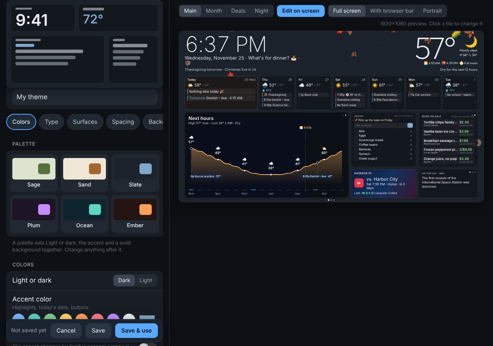
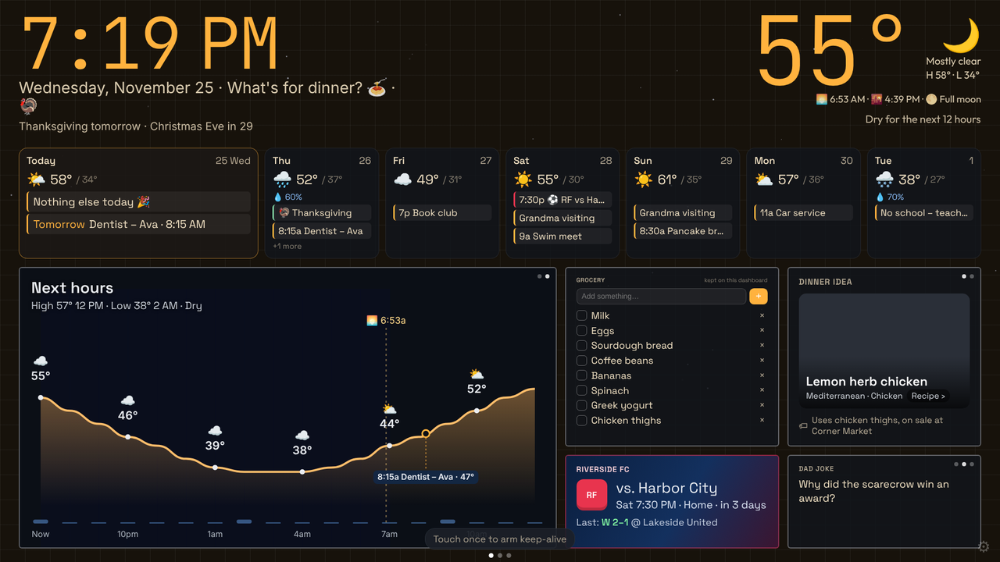
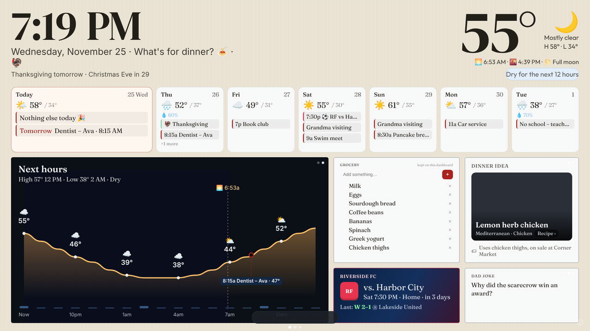
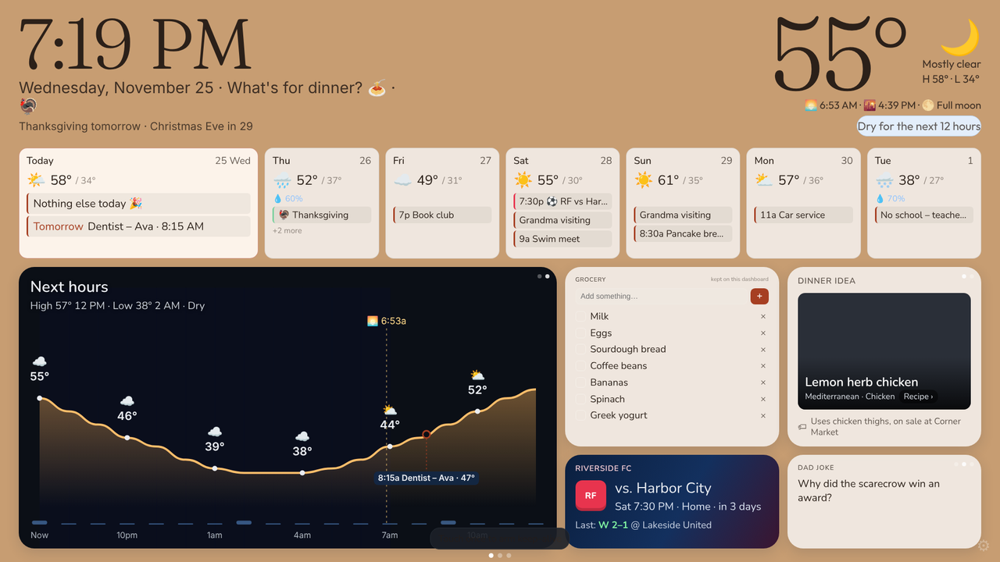
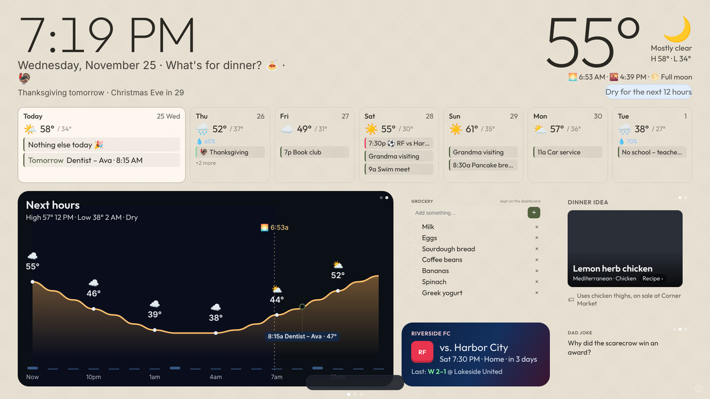
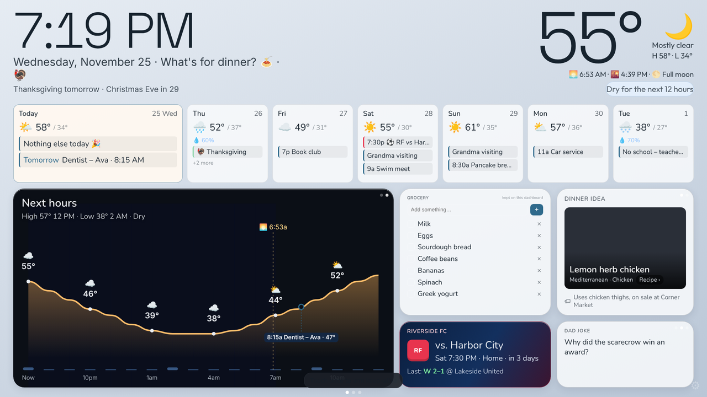
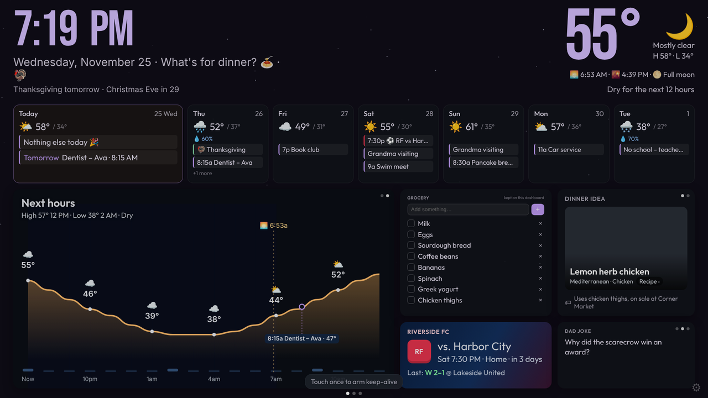
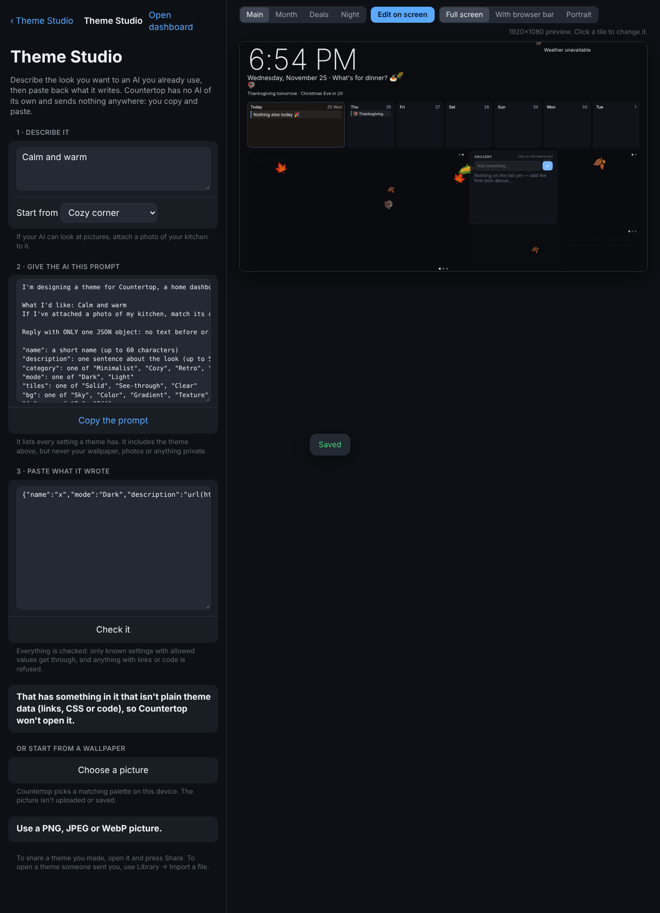
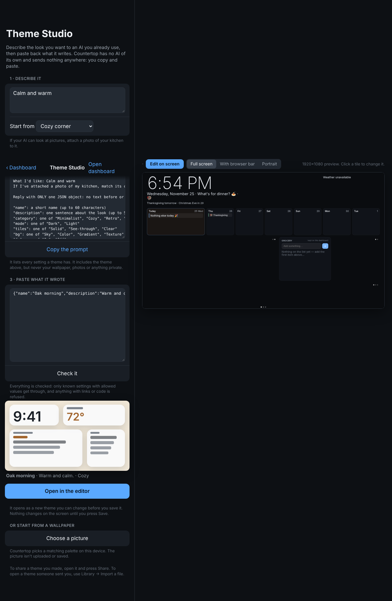
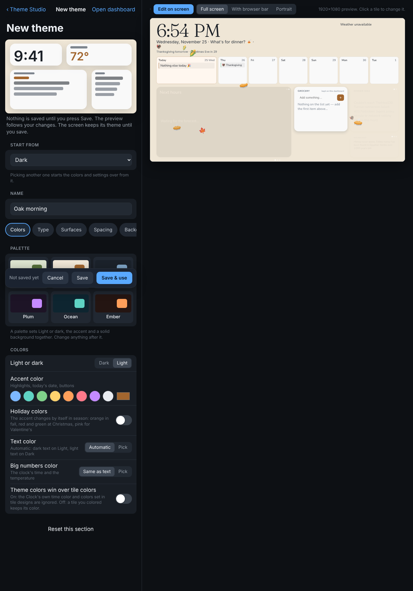

# How a theme becomes what you see

Every color, size and shape on the dashboard comes from one of these layers. A later layer wins over an earlier one.

1. **Built-in defaults.** What Everyday and the built-in themes start from (`THEMELIB.BASE` in `tools/shared/themes.js`).
2. **The active theme.** The theme in use, or the one a schedule rule picks. It fills in every theme setting.
3. **Tile presets and tile designs.** A tile's own colors, such as the Clock's time color or a tile design's part colors. These beat the theme.
4. **Theme colors win over tile colors.** When this theme switch is on, layer 3's colors are ignored and the theme's text and big-number colors are used.
5. **Holiday accents.** On a holiday's day the accent color is replaced by the holiday's. Nothing else changes.

Meaningful colors do not follow the theme: green for savings and prices, red for alerts, amber for warnings, the Team tile's team colors, and the photo tiles' white text over pictures.

## One resolver

`THEMELIB.resolve(values)` (in `tools/shared/themes.js`) turns a theme's values into the final colors: text, dimmer text, big numbers, tile background, border and accent. The dashboard (`themeApply` in `tools/dash/looks.js`) and the Controls previews (`lookColors` in `tools/control/look.js`) both call it, so the preview and the real screen agree.

## Tokens

`tools/dash/style.css` defines semantic tokens on `:root` (and `html.light`): `--text`, `--text-dim`, `--text-faint`, `--surface`, `--surface-line`, `--inset`, `--accent`, the status colors `--ok`, `--info`, `--warn`, `--bad`, and the shape tokens `--font`, `--radius`, `--pad-y`, `--pad-x`, `--gap`, `--shadow`. The older names (`--fg`, `--dim`, `--card`, `--line` and so on) stay as they are, because community tiles and tile designs use them. Use a token instead of a hard-coded color in tile styles. The editor's own controls keep their fixed colors.

## Theme options

A theme carries these settings besides its colors (all in `THEMELIB.BASE`; `THEMELIB.tokens(values)` turns them into the tokens above, and the dashboard and the Controls previews both use it):

- **Fonts.** Text font (five that read well small) and Big numbers font (all eight bundled fonts, or Default: each tile's own). A font picked in a Clock or Weather design beats the theme's Big numbers font. Community tiles get both through `fontDisplay` in the theme they receive.
- **Tile edges and corners.** Edges: Classic (as before), Flat, Soft, Outline, Glass (a bright edge and a shine, no blur). Corners: Square, Rounded (as before), Soft.
- **Spacing.** Compact, Normal (as before) or Roomy: the gap between tiles, the padding in tiles and the margin around the page. The grid editor reads the gap through `gapPx()`, so boxes are placed the way they are drawn.
- **Background.** Sky, Color, Gradient, Texture (drawn in CSS over the background color), Wallpaper, or Photos (an album of your choice, changing every few minutes), then an optional tint over it and the existing dimming. There is no blur.
- **Effects.** A theme can name the effects it plays; none named means the ones turned on in Effects.

An old theme has none of these keys and gets the defaults, which draw exactly what it drew before (`tests/theme-compat-check.js`).

## The editor

Themes → a theme → Customize (or New theme) opens a draft with six tabs: Colors (palette presets, accent, text colors), Type, Surfaces, Spacing, Background and Effects. Each choice is a picture, the preview beside it follows the draft, and **Reset this section** puts one tab back to how the theme was. Nothing is saved until Save. In a Clock design or the tile designer, a **Theme** swatch makes a color follow the theme (Theme colors win still decides who wins). `tools/control/look-editor.js` holds the tabs; a new theme setting needs a place in `LTAB_KEYS` there.

## What may leave this Countertop

A **wallpaper** is a picture uploaded to this Countertop's own data folder (PNG, JPEG or WebP, up to 8 MB, checked by its first bytes; `tools/server/wallpaper.py`). A theme only names its id, and a **photo album** is only named by its id too. Neither may travel. Everything that leaves goes through `THEMELIB.portable(values)`: a shared theme, a shared layout, a gallery submission and a Theme Studio prompt all call it, so a setting can't leak by being forgotten in one place. It drops the settings listed in `THEMELIB.LOCAL`, turns a theme on a wallpaper into a gradient one, and keeps only effects everyone has. Files and codes coming in are read with the same list: a wallpaper or album named in a shared file is ignored.

## The six newer built-in themes

Retro digital, Newspaper, Mid-century, Japandi, Nordic and After hours use the options above to look like different products, not one dashboard in six colors. Each is a plain entry in `THEMELIB.L` with a fixed `builtin-` id.

| Theme | Fonts (text / big numbers) | Edges, corners, spacing | Background |
| --- | --- | --- | --- |
| Retro digital | Space Grotesk / JetBrains Mono | Outline, Square, Normal | Grid texture on near-black, amber numbers, stars |
| Newspaper | Fraunces / DM Serif Display | Outline, Square, Normal | Paper texture, red accent, no effects |
| Mid-century | Nunito / Fraunces | Soft, Soft corners, Normal | Walnut tan with see-through cream tiles |
| Japandi | Outfit / Outfit | Flat, Soft corners, Roomy | Linen texture, no tile boxes |
| Nordic | Nunito / Space Grotesk | Glass, Soft corners, Normal | Mist gradient, snow and clouds |
| After hours | Outfit / Bebas Neue | Soft, Rounded, Normal | Deep violet, dimmed, stars |

`node tests/theme-contrast-check.js` works out the color a tile really draws (its see-through surface over the theme's background, the worst end of a gradient) and requires the text to reach 7:1, dimmer lines and the accent 4.5:1, for these six. Adding a built-in theme means passing that check. The older ten are left as they were (Light's accent is 3.8:1 on its tiles; it is not changed because people's saved looks and schedules name it).

## Stress matrix

`node tests/stress-matrix-check.js` draws the dashboard on four screens (1920x1080, 1280x800 and two portrait sizes) in the six themes, Dark, Light, a Compact and a Roomy theme, with the demo data, with extremes (long names, nine events a day, a 45-item list with a long note, a team with a long name) and with nothing at all. Every combination must draw without errors, not scroll, keep every tile on the screen and off its neighbors, and keep each tile's main content in view. `SHOTS=<folder>` saves a screenshot of each combination.

A theme's font arrives after the first draw and changes how tall lines are, so tiles fit again when fonts finish loading (`tools/dash/grid.js`); the Month and Week tiles, which fit their own events, draw again too.

## Keeping it unchanged

`node tests/theme-compat-check.js` loads the dashboard in every built-in theme and a few custom ones and compares the computed colors, borders, radius, padding, gaps and shadows of the elements with `tests/fixtures/theme-compat.json`. If a change should alter the look, regenerate the file with `--write` and say why in the pull request.

## Theme Studio

Themes → Theme Studio makes a new theme without touching every setting. Countertop has no AI of its own and sends nothing anywhere:

1. Describe the look and copy the prompt. It lists every setting a theme has and, as a starting point, the theme you picked (never your wallpaper, photo album or anything else private: it goes through the same portable-theme step as sharing). If your AI can look at pictures, attach a photo of your kitchen.
2. Paste back what it writes. Countertop checks it setting by setting: only known settings with allowed values (the same lists as the theme editor), colors as six-digit hex, whole numbers in range, text up to 60 or 500 characters. Anything with links, CSS or code anywhere in the reply, or a reply over 20,000 characters, is refused outright. A setting that doesn't pass is left out and listed; the rest opens.
3. **Open in the editor** starts an ordinary new-theme draft: the same live preview, Save, Save & use and Cancel as a theme made by hand. Nothing is saved until you press Save.

Or choose a picture under "Or start from a wallpaper": Countertop picks a palette from it on this device (light or dark, a background color and an accent that reads on it) and opens it the same way. The picture isn't uploaded or stored.

A theme can be filed under one category when you share it (Minimalist, Cozy, Retro, Seasonal, Nature, Futuristic, High Contrast). It's optional, travels in the share file and the gallery submission, and is ignored if it isn't one of those.

